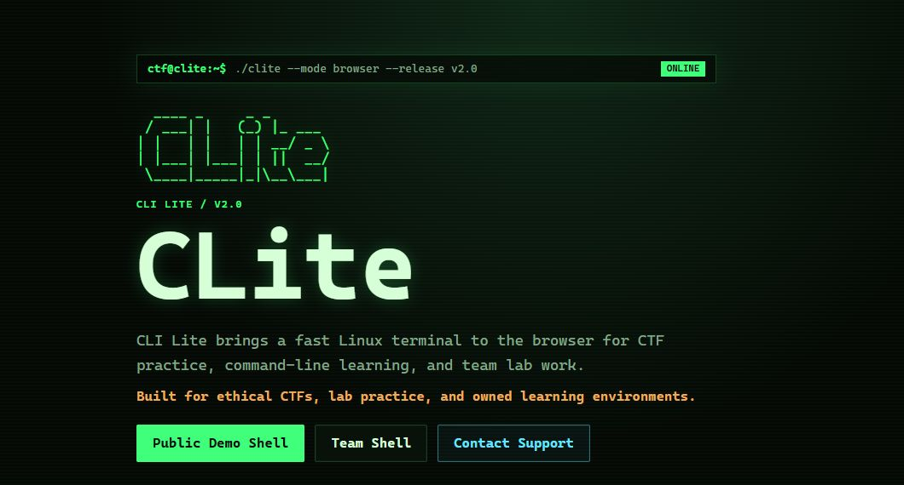

<div align="center">

# CLite

<pre>
  ____ _     _ _
 / ___| |   (_) |_ ___
| |   | |   | | __/ _ \
| |___| |___| | ||  __/
 \____|_____|_|\__\___|
</pre>

**Your CTF workspace. One browser tab.**

Real Linux · Bun + TypeScript · Python · xterm.js

[Open CLite](https://clite.tahmidkhan.com.bd) &nbsp; · &nbsp; [Try the public demo](https://clite.tahmidkhan.com.bd/demo) &nbsp; · &nbsp; [Read the guide](docs/GUIDE.md)

</div>

[](https://clite.tahmidkhan.com.bd)

**CLite means CLI Lite.** A browser workspace for CTF competitions, command-line learning, and team labs. Open the public demo to follow a trail of evidence, or enter Team Shell for a real Debian Linux environment with tools ready to use.

## Two ways in

| | Public demo | Team Shell |
| :--- | :--- | :--- |
| Access | Open to everyone | Your team's shared key |
| Environment | A contained practice shell | Real non-root Linux and Bash |
| Explore | Linked cases, hidden clues, and public research | Challenge files, networking, reversing, crypto, and forensics |
| Make it yours | Notes, uploads, and portable quest progress | Install packages, build tools, and restore dependencies |
| Begin with | `case` | `clite help` |

<details>
<summary><strong>Preview the public demo</strong></summary>


A detective trail through Bangladesh, science, folklore, and cinema. Follow clues between the terminal, this site, and read-only public sources. Each solved lead opens another part of the investigation.

</details>

<details>
<summary><strong>Preview Team Shell</strong></summary>


An actual Linux workspace for trusted teammates. Bring a challenge, install what it needs, and keep your workflow in the terminal.

</details>

## Ready for competition day

- **A familiar toolchain.** Networking, web, reversing, forensics, stego, crypto, compilers, editors, and Python tools.
- **Room to experiment.** Session-local `pip`, `pipx`, and Debian package installation, updates, and upgrades.
- **Connection recovery.** Refresh or reconnect within the grace period to recover your shell, files, jobs, and recent output.
- **Clear session controls.** Separate idle and lifetime limits, countdowns, expiry warnings, and a Keep working action.
- **Work you can take with you.** Upload evidence, download a workspace, save a transcript, and snapshot dependencies.

```sh
clite tools                    # Explore the installed toolchain
clite doctor                   # Check your workspace
clite init warmup              # Start a challenge folder
pip install PACKAGE            # Add a Python dependency
clite system install PACKAGE   # Add a user-local Debian package
clite snapshot                 # Record dependencies before exporting
```

## Run your own

```sh
cp .env.example .env
# Configure your private keys and session settings in .env.
docker build -t clite .
docker run --name clite -p 7860:7860 --env-file .env clite
```

Open **http://localhost:7860**. Set a `TEAM_KEY` of at least 16 characters and supply the matching private `QUEST_MASTER_KEY` for the encrypted quest. Keys and quest authoring files stay outside the public repository.

Runtime defaults live in [`.env.example`](.env.example); `.env` and hosting variables override them. For Render deployment, package management, tool inventory, and configuration, see the **[operations guide](docs/GUIDE.md)**.

Workspaces are temporary. Export important work before session expiry, deployments, or server restarts. Team Shell is intended for trusted teammates and authorized CTF or lab environments.

<details>
<summary><strong>Local development</strong></summary>

```sh
bun install --frozen-lockfile
bun run typecheck
bun test
python -m unittest discover -s tests -p 'test_*.py'
bun run dev
```

Use `dev` for development. Render deploys production from `main`. Docker provides the supported Linux environment for Team Shell.

</details>

---

<div align="center">

Created by **Tahmid Khan** · **CLite 2.0**

[Live site](https://clite.tahmidkhan.com.bd) · [Report an issue](https://github.com/tahmidkhanshuvo/CLite/issues) · [Contact support](mailto:admin@tahmidkhan.com.bd)

</div>
