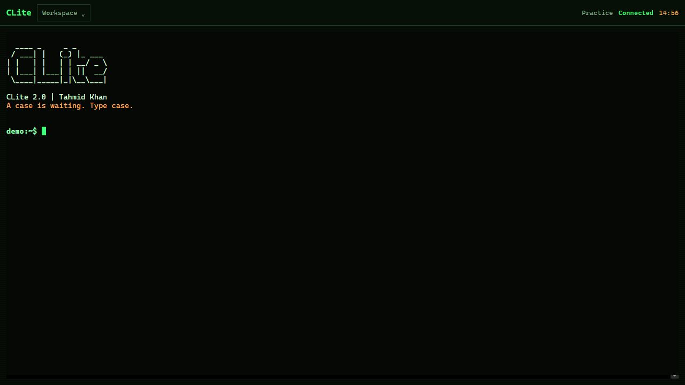
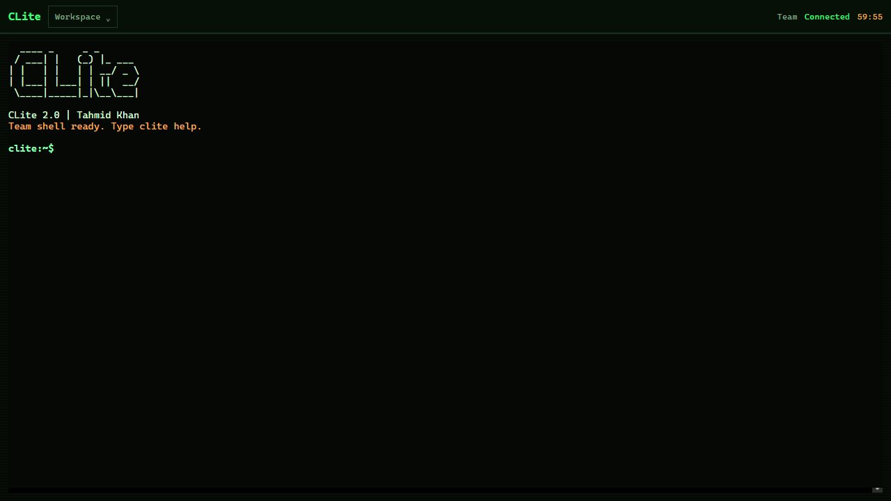

# CLite

```text
  ____ _     _ _
 / ___| |   (_) |_ ___
| |   | |   | | __/ _ \
| |___| |___| | ||  __/
 \____|_____|_|\__\___|
```

**CLI Lite — a portable Linux CTF workspace in your browser.**

Real Debian Linux, a ready-to-use security toolchain, and an original detective trail hidden in the margins. Built for ethical competitions, lab practice, and systems you are authorized to test.

[Live site](https://clite.tahmidkhan.com.bd) · [Public practice](https://clite.tahmidkhan.com.bd/demo) · [Operations guide](docs/GUIDE.md)

## A familiar terminal

### Public practice



Follow a trail through Bangladesh, bookshop margins, science, folklore, and cinema. Recover evidence from files, simulated targets, and read-only public research, then let each accepted flag reveal the next lead. OSINT, web, crypto, forensics, stego, reversing, pwn, networks, programming, and specialist exhibits belong to the same investigation.

```sh
case
cat CASEFILE.md
help
```

### Team workspace



A real non-root Bash shell with networking, reversing, forensics, crypto, compilers, editors, and Python tools. Install what a challenge needs in your own workspace.

```sh
clite tools
clite doctor
clite init warmup
pip install PACKAGE
pipx install PACKAGE
clite system install PACKAGE
```

## Made for competition days

- Recover the same shell, files, and jobs after a short connection loss or page refresh.
- Separate idle and lifetime settings, clear countdowns, and warnings before expiry.
- Upload evidence, save terminal output, and download your workspace.
- Snapshot and restore session-local dependencies with `clite snapshot` and `clite restore`.
- Keep the classic green terminal, clean layout, and ASCII identity.

## Run your own

```sh
cp .env.example .env
# Set a strong TEAM_KEY and adjust the session settings in .env.
docker build -t clite .
docker run --name clite -p 7860:7860 --env-file .env clite
```

Open **http://localhost:7860**. Public practice needs no sign-in; Team Shell uses your configured key.

Runtime defaults live in `.env.example`, with `.env` and hosting variables taking precedence. Real env files stay outside Git and Docker images. On Render, import your private env settings and use `/healthz` as the health check. Preserve your existing team key when importing if you do not want to rotate access. The private `QUEST_MASTER_KEY` is also required to open the encrypted quest; never publish it.

Team workspaces are temporary and intended for trusted teammates. Download important work before expiry or a server restart. The [operations guide](docs/GUIDE.md) explains the tool inventory, package installation, deployment settings, persistence, and trust boundaries.

## Development

```sh
bun install --frozen-lockfile
bun run typecheck
bun test
python -m unittest discover -s tests -p 'test_*.py'
bun run dev
```

Bun + TypeScript power the backend; xterm.js provides the terminal. `dev` is the development branch, and `main` is the production branch used by Render.

## Creator and support

Created by **Tahmid Khan**. For help, feedback, or access questions: **admin@tahmidkhan.com.bd**.
